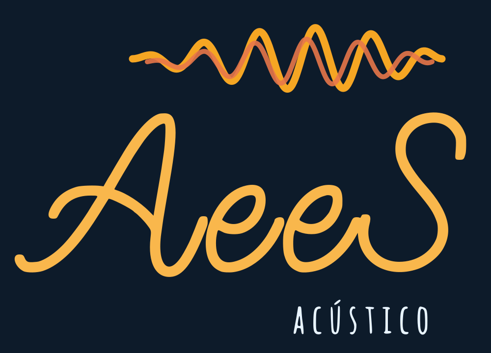
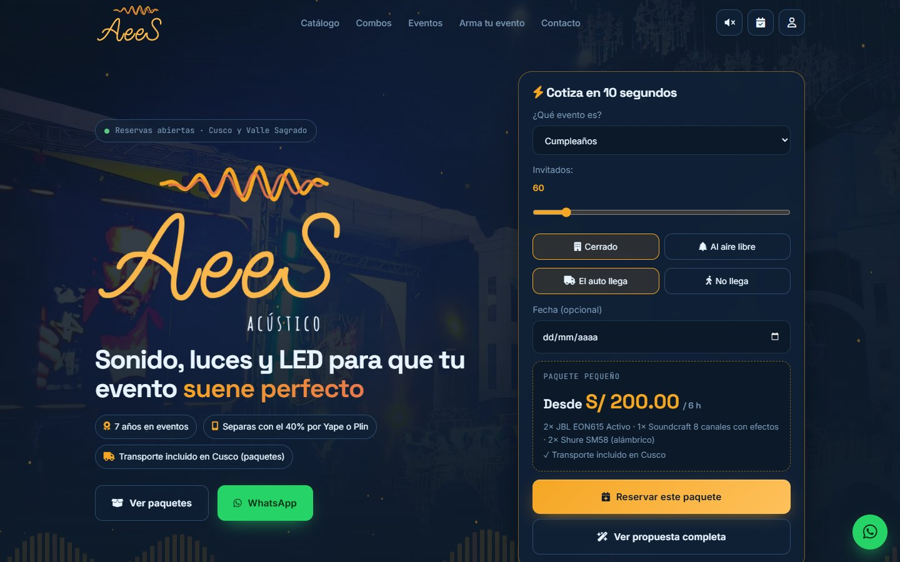
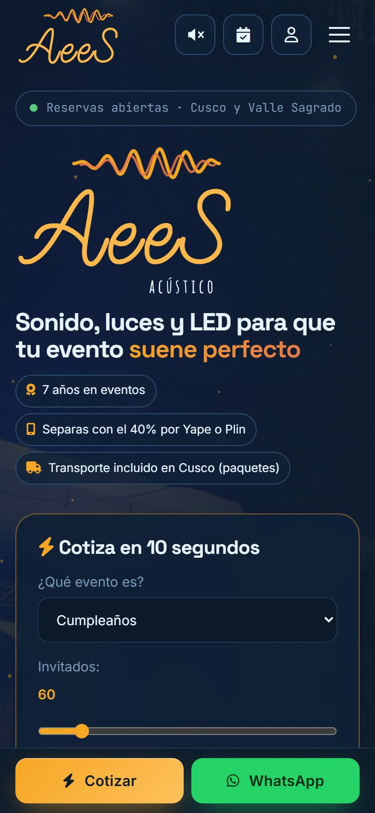
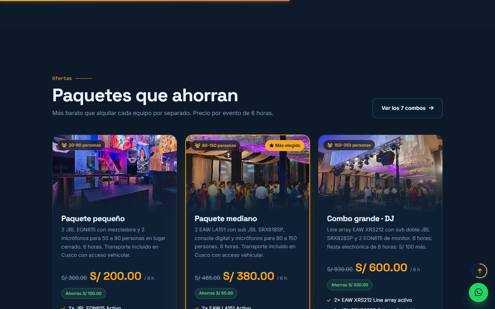
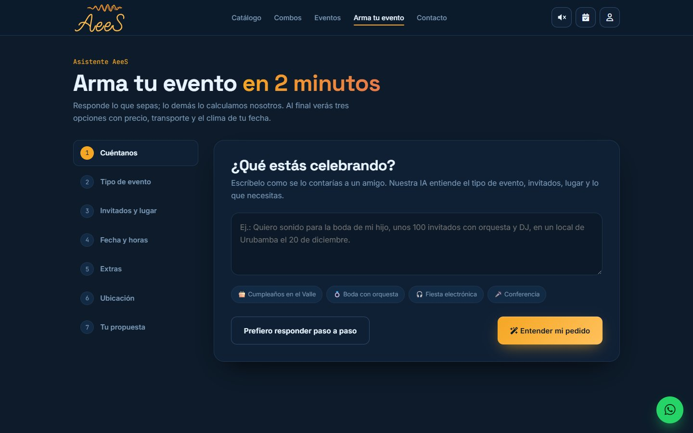
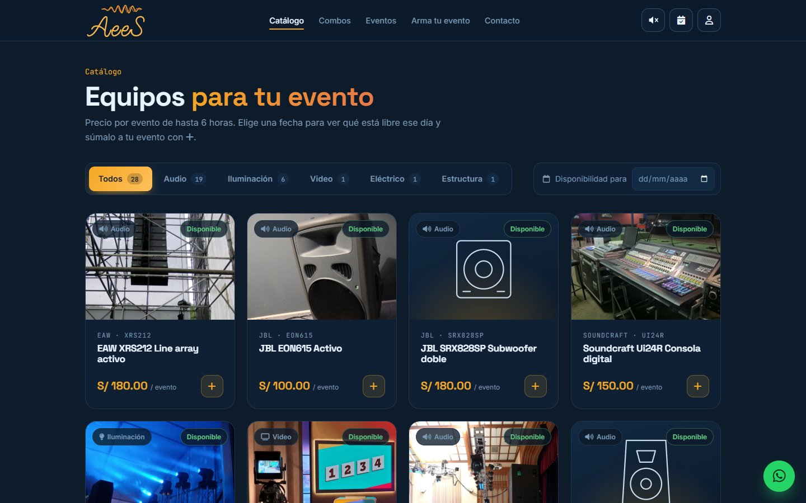
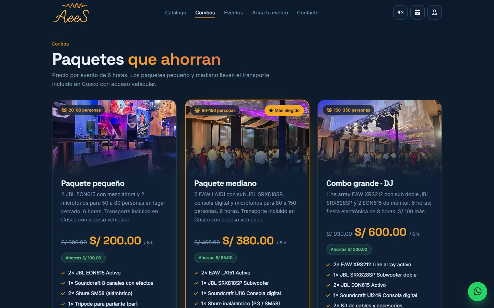
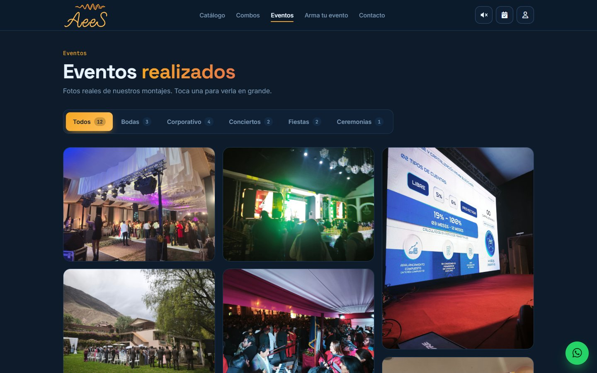
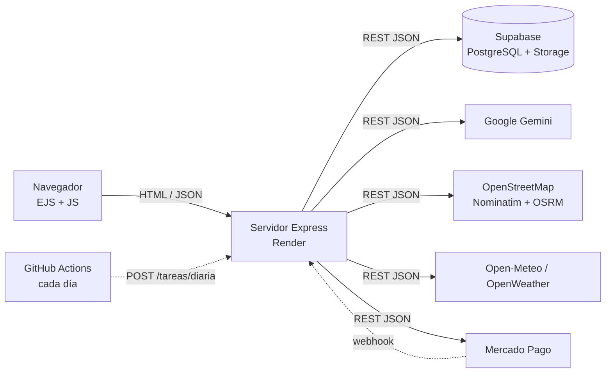

<p align="center">
  
</p>

<h1 align="center">AeeS Acústico — Web de alquiler de equipos audiovisuales</h1>

<p align="center">
  Sonido, iluminación, pantallas LED y estructuras para bodas, fiestas, conciertos y eventos corporativos en Cusco y el Valle Sagrado.
</p>

<p align="center">
  <a href="https://aees-web.onrender.com"></a>
</p>

<p align="center">
  
  
  
  
  
  
  
  
</p>

---

## Tabla de contenidos

1. [Descripción](#1-descripción)
2. [Demo y capturas](#2-demo-y-capturas)
3. [Funcionalidades](#3-funcionalidades)
4. [APIs integradas](#4-apis-integradas)
5. [Arquitectura](#5-arquitectura)
6. [Tecnologías](#6-tecnologías)
7. [Estructura del proyecto](#7-estructura-del-proyecto)
8. [Instalación y ejecución local](#8-instalación-y-ejecución-local)
9. [Variables de entorno](#9-variables-de-entorno)
10. [API REST del proyecto](#10-api-rest-del-proyecto)
11. [Base de datos y archivos](#11-base-de-datos-y-archivos)
12. [Reglas del negocio](#12-reglas-del-negocio)
13. [Despliegue y mantenimiento](#13-despliegue-y-mantenimiento)
14. [Pruebas](#14-pruebas)
15. [Seguridad](#15-seguridad)
16. [Solución de problemas](#16-solución-de-problemas)
17. [Hoja de ruta](#17-hoja-de-ruta)
18. [Créditos y licencias de terceros](#18-créditos-y-licencias-de-terceros)
19. [Autores y licencia](#19-autores-y-licencia)

---

## 1. Descripción

**AeeS Acústico** es una empresa de alquiler de equipos audiovisuales en Cusco, con almacén en la Urb. Larapa Grande (San Jerónimo). Esta aplicación web le permite:

- **Al cliente:** cotizar en segundos, ver el catálogo real con **disponibilidad por fecha**, armar su evento con un **asistente con inteligencia artificial**, ubicar el lugar en un **mapa** (ruta, transporte y clima), **reservar pagando un adelanto con Yape o Plin** y, como cliente habitual, entrar solo con su **Gmail y celular** para sumar **puntos** y repetir reservas.
- **Al negocio:** administrar equipos, paquetes, precios, reservas, pagos, clientes, reseñas, promociones y la galería desde un **panel con roles**; registrar clientes y reservas por teléfono; y tener **respaldos automáticos diarios**.

> Proyecto de fin de la **Unidad II** del curso **Desarrollo de Software II** — Ingeniería de Sistemas, Universidad Andina del Cusco. Requisito: una plataforma que resuelva un problema real integrando **3 APIs externas** que intercambian mensajes **JSON** por HTTP.

## 2. Demo y capturas

| Recurso | Enlace |
|---|---|
| Sitio público | https://aees-web.onrender.com |
| Catálogo de equipos | https://aees-web.onrender.com/catalogo |
| Combos y paquetes | https://aees-web.onrender.com/combos |
| Eventos realizados | https://aees-web.onrender.com/eventos |
| Asistente "Arma tu evento" | https://aees-web.onrender.com/asistente |
| Ingreso de clientes | https://aees-web.onrender.com/cuenta/ingresar |
| Panel de administración | https://aees-web.onrender.com/admin (solo personal, con contraseña) |
| Estado del servidor | https://aees-web.onrender.com/salud |

> El hosting gratuito "se duerme" tras 15 minutos sin visitas. De 6:00 a 23:59 una tarea automática lo mantiene despierto; de madrugada, la primera carga puede tardar unos 50 segundos.

| Portada con cotizador rápido | En el celular |
|---|---|
|  |  |
| **Paquetes en la portada ("Más elegido")** | **Asistente con IA** |
|  |  |
| **Catálogo con disponibilidad** | **Combos y paquetes** |
|  |  |



## 3. Funcionalidades

### Portada (resumen que lleva a cada página)
- **Cotizador rápido**: tipo de evento, invitados, lugar cerrado o al aire libre, si el vehículo llega y la fecha → *"Desde S/ 200, transporte incluido"* al instante, con botón para reservar ese paquete.
- **Promociones** vigentes con su código, **cotizador con IA** (escribe tu evento con tus palabras), **3 equipos destacados**, **reseñas reales** junto a **fotos de eventos que cambian cada 2 segundos** y **3 paquetes** con el "Más elegido" y el precio por separado tachado.
- Páginas propias: **/catalogo** (filtros y disponibilidad por fecha), **/combos** y **/eventos** (galería y reseñas).
- En el celular, **barra fija** con "Cotizar" y "WhatsApp".
- Logo animado, botón de volumen y títulos que "suenan" al pasar el mouse (Web Audio API); haces de luz, ecualizador en canvas, tilt 3D y aparición al hacer scroll.

### Asistente "Arma tu evento"
1. El cliente escribe con sus palabras (*"boda de 120 invitados con orquesta en Urubamba"*) y la **IA lo convierte en la encuesta**.
2. Completa tipo de evento, invitados, interior o exterior, fecha, horas y extras. Con **orquesta o banda** pide integrantes, horas del grupo y si traen su propio monitoreo, para ajustarse a su **rider técnico**.
3. Marca el lugar en el **mapa** y responde si el **vehículo llega hasta el lugar**: se calcula la ruta real desde el almacén.
4. Recibe **3 opciones** (Esencial, Recomendada y Premium) más un paquete sugerido, con transporte, técnico, clima y una explicación personalizada.

### Cliente habitual
- Ingreso **sin contraseñas**: solo **Gmail y celular**; queda recordado **6 meses** en su dispositivo (también con Google si se configura).
- **Puntos**: 1 punto por cada S/ 100 de eventos realizados; 5 puntos = S/ 50 de descuento. Se canjean en "Mi evento".
- **Mi cuenta**: puntos con barra de avance, descuento de cliente frecuente, reservas con botón **Repetir** y **reseña** de los eventos ya realizados.

### Reservas y pagos
- El adelanto (40 %) **bloquea los equipos y la fecha durante 24 h**.
- **Yape o Plin**: el cliente ve el QR y el monto, sube la **captura del comprobante** y el **número de operación**, y avisa por **WhatsApp** con el mensaje ya escrito. El admin compara y aprueba. Tarjeta con **Mercado Pago** (opcional).
- **Condiciones del servicio** que el cliente acepta: energía eléctrica estable, protección ante lluvia y sol, y confirmación del evento en la **reunión o llamada** que agenda AeeS.
- Si la fecha está ocupada, el cliente puede pedir una alternativa con un proveedor aliado.

### Panel de administración (`/admin`)
| Rol | Acceso |
|---|---|
| **Administrador** | Agenda y calendario, reservas, pagos, clientes, mensajes, equipos, combos, galería, reseñas, promociones, ajustes y tarifas, personal, respaldo |
| **Publicador** | Combos, galería y reseñas |

- **Clientes**: registrarlos con Gmail y celular, buscarlos, editarlos y ver sus puntos y reservas.
- **Reservas**: crear una desde el **"+" de cada día del calendario**, con precio en vivo, pago recibido y opción de proveedor aliado; editar datos del evento; **ajustar el precio** con motivo e historial; agendar la reunión o llamada (sin ella no se puede confirmar).
- **Pagos**: ver la foto del comprobante de Yape/Plin y aprobar o rechazar.
- CRUD de equipos (con "Destacado" para la portada), paquetes con vista previa y ahorro, galería, reseñas, promociones y personal.
- Fotos en cualquier formato común, **recortadas y guardadas al tamaño exacto** de su espacio en el sitio, en WebP.
- **Ajustes**: datos del negocio, almacén, Yape y Plin, condiciones del servicio, reglas de precios, transporte incluido y puntos.
- **Respaldo**: descarga y restauración en JSON, más los **respaldos automáticos diarios**.

## 4. APIs integradas

Todas se consumen desde el servidor y comunican mensajes **JSON** por HTTP.

| # | Rol | API | Uso | Archivo | Plan B si falla |
|---|---|---|---|---|---|
| 1 | Mapa y rutas | **OpenStreetMap** — Nominatim + OSRM (OpenRouteService opcional) | Geocodificar el lugar, ruta real por carretera, km y minutos, enlace para el conductor | `src/servicios/rutas.js` | Estimación en línea recta × 1.35 |
| 2 | Inteligencia artificial | **Google Gemini** (gratuita) o **Claude** de Anthropic | Interpretar texto libre → JSON de la encuesta; redactar la explicación | `src/servicios/ia.js` | Intérprete por palabras clave |
| 3 | Pagos | **Mercado Pago Checkout Pro** + Yape/Plin con comprobante | Cobro del adelanto; verificación por webhook y consulta a la API | `src/servicios/pagos.js`, `src/rutas/pagos.js` | Yape/Plin verificado por el admin |
| + | Clima | **OpenWeather** / **Open-Meteo** | Pronóstico del día del evento; sugiere toldo si llueve | `src/servicios/clima.js` | Aviso por temporada de lluvias |
| + | Altura del lugar | **Open-Meteo Elevation** | Saber si el lugar está en un cerro (regla de transporte incluido) | `src/servicios/rutas.js` | Se confirma en la reunión |

**Ejemplo de mensaje con la API de IA:**
```text
→ {"texto": "Quiero sonido para la boda de mi hijo, 150 invitados con orquesta en Urubamba el 20 de diciembre"}
← {"tipo_evento":"boda","personas":150,"espacio":"exterior","lugar":"Urubamba","fecha":"2026-12-20","extras":{"orquesta":true,"dj":false}}
```

> **Decisión de diseño:** la IA **no decide** qué equipos van ni cuánto cuestan. Eso lo hace el motor de reglas `src/servicios/recomendador.js` con el stock real del día. La IA solo interpreta y redacta. Así los precios nunca se inventan, y si la IA falla el sitio sigue funcionando.

## 5. Arquitectura



- El navegador **nunca accede directamente** a la base de datos ni a las claves: todo pasa por el servidor.
- La capa de datos (`src/db/`) tiene **dos motores con la misma interfaz**: Supabase en producción y un archivo JSON local para desarrollo (patrón *Repository*).
- Supabase Storage tiene un bucket **público** (`fotos` del sitio) y dos **privados** (`comprobantes` de pago y `respaldos` diarios).

## 6. Tecnologías

| Capa | Tecnología |
|---|---|
| Servidor | Node.js 22, Express 5, cookie-session |
| Vistas | EJS, HTML5, CSS3 (variables, grid, animaciones), JavaScript sin frameworks |
| Librerías del navegador (CDN) | Leaflet, GSAP, SweetAlert2, Cropper.js, Font Awesome |
| Base de datos y archivos | Supabase (PostgreSQL y Storage), `@supabase/supabase-js` |
| IA | Google Gemini (REST), Claude (`@anthropic-ai/sdk`) |
| Despliegue y tareas | Render (Blueprint), GitHub Actions, Vercel (configurado) |
| Pruebas | `node:test` (corredor nativo de Node) |

## 7. Estructura del proyecto

```text
aees_web/
├── app.js                   # Arma la app Express: seguridad, sesión, CSRF, rutas, tarea diaria, errores
├── server.js                # Enciende el servidor (Render / PC)
├── api/index.js             # Entrada para Vercel
├── render.yaml              # Blueprint de Render
├── vercel.json              # Configuración de Vercel
├── .github/workflows/       # mantenimiento.yml: respaldo diario y sitio despierto
├── data/semilla.json        # Inventario real, paquetes, ajustes y galería iniciales
├── supabase/esquema.sql     # Tablas de PostgreSQL
├── scripts/                 # cargar-semilla.js, precios-2026-11.js
├── src/
│   ├── db/                  # Acceso a datos: supabase.js | local.js (misma interfaz)
│   ├── lib/                 # seguridad.js (scrypt, CSRF, límites), util.js
│   ├── middleware/auth.js   # Sesión, roles y contraseña en acciones delicadas
│   ├── rutas/               # publico, cuenta, api, pagos, admin
│   └── servicios/           # catalogo, precios, puntos, recomendador, transporte, rutas, clima,
│                            # ia, pagos, reservas, resenas, negocio, tareas
├── views/                   # Plantillas EJS (sitio, cuenta, panel admin, parciales)
├── public/                  # css, js, img (logo, eventos, equipos)
├── test/reglas.test.js      # Pruebas de las reglas del negocio
└── docs/capturas/           # Capturas del sitio
```

## 8. Instalación y ejecución local

**Requisitos:** Node.js 22 y Git. En Windows PowerShell, ejecuta los comandos **uno por uno** (PowerShell no usa `&&`).

```powershell
git clone https://github.com/020200141d-coder/aees_web.git
```
```powershell
cd aees_web
```
```powershell
npm install
```
```powershell
Copy-Item .env.example .env
```

Edita `.env` y completa al menos `ADMIN_EMAIL`, `ADMIN_PASS` y `SESSION_SECRET`. Sin las claves de Supabase, los datos se guardan en `data/db.local.json`.

```powershell
npm run dev
```

Abre http://localhost:3000 y el panel en http://localhost:3000/admin.

| Script | Qué hace |
|---|---|
| `npm start` | Inicia el servidor (producción) |
| `npm run dev` | Inicia con recarga automática |
| `npm test` | Ejecuta las pruebas |
| `npm run semilla` | Carga equipos, paquetes, galería y ajustes en la base activa |
| `npm run precios` | Aplica los precios y paquetes vigentes a la base activa (no borra nada) |

## 9. Variables de entorno

Plantilla completa en [`.env.example`](.env.example). **Nunca subas el archivo `.env` a GitHub.**

| Variable | Obligatoria | Descripción |
|---|---|---|
| `ADMIN_EMAIL`, `ADMIN_PASS` | Sí | Cuenta **principal** de administrador (la del dueño): se crea al arrancar y no se puede borrar |
| `SESSION_SECRET` | Sí | Texto aleatorio para firmar la cookie de sesión |
| `NODE_ENV`, `PORT`, `BASE_URL` | En producción | Modo, puerto y URL pública (la usa Mercado Pago) |
| `SUPABASE_URL`, `SUPABASE_SERVICE_KEY` | Recomendada | Base de datos; usar la clave **secret**, nunca la *publishable* |
| `TAREAS_TOKEN` | Recomendada | Clave de la tarea diaria; el **mismo valor** va en GitHub → Secrets → Actions |
| `GEMINI_API_KEY` | Opcional | IA gratuita ([aistudio.google.com/apikey](https://aistudio.google.com/apikey)) |
| `ANTHROPIC_API_KEY` | Opcional | IA de pago (Claude) |
| `GOOGLE_CLIENT_ID` | Opcional | Botón "Continuar con Google" |
| `MP_ACCESS_TOKEN` | Opcional | Mercado Pago (de prueba: empieza con `TEST-`) |
| `OPENWEATHER_API_KEY`, `ORS_API_KEY` | Opcional | Clima y rutas con clave propia |

## 10. API REST del proyecto

| Método | Ruta | Descripción | Sesión |
|---|---|---|---|
| GET | `/api/equipos?fecha=AAAA-MM-DD` | Catálogo con unidades libres ese día | No |
| POST | `/api/cotizacion-rapida` | Cotizador de la portada: paquete sugerido y precio "desde" | No |
| POST | `/api/interpretar` | Texto libre → campos de la encuesta (IA) | No |
| POST | `/api/recomendar` | Encuesta → 3 opciones, paquete, ruta, clima y explicación | No |
| GET | `/api/geocodificar?q=` | Buscar un lugar | No |
| POST | `/api/ruta` | Ruta desde el almacén hasta el lugar | No |
| GET | `/api/clima?lat=&lng=&fecha=` | Pronóstico del día | No |
| POST | `/api/cotizar` | Precio final del evento armado (con puntos y descuentos) | No |
| POST | `/api/reservas` | Crear la reserva | Cliente |
| POST | `/pagos/:codigo/yape` | Comprobante de Yape/Plin (foto + n.º de operación) | Cliente |
| POST | `/api/contacto` | Mensaje o cotización | No |
| POST | `/api/solicitudes` | Fecha ocupada → pedir reunión | No |
| POST | `/pagos/mercadopago/webhook` | Aviso de pago de Mercado Pago | — |
| POST | `/tareas/diaria` | Respaldo diario (cabecera `Authorization: Bearer TAREAS_TOKEN`) | Clave |
| GET | `/salud`, `/salud/base` | Estado del servidor y de la base | No |

Respuestas en JSON: `{ "ok": true, ... }` o `{ "ok": false, "error": "..." }`. Códigos usados: `200`, `400` (validación), `401` (sin sesión, clave o contraseña), `403` (CSRF o rol), `404`, `409` (equipo ya reservado esa fecha), `429` (demasiadas peticiones), `500`.

## 11. Base de datos y archivos

Definida en [`supabase/esquema.sql`](supabase/esquema.sql):

| Tabla | Contenido |
|---|---|
| `ajustes` | Datos del negocio (almacén, Yape, Plin, condiciones), reglas de precios y puntos, vehículos, fotos de portada y reseñas |
| `equipos` | Inventario: precio por evento, stock, rol técnico, medidas para el transporte, foto, crédito y "destacado" |
| `combos` | Paquetes con sus equipos y adicionales |
| `promociones` | Códigos de descuento |
| `publicaciones` | Galería de eventos realizados |
| `usuarios` | Clientes y personal (roles `admin`, `publicador`, `cliente`) |
| `reservas` | Evento, equipos, desglose de precio congelado, adelanto, estado, reunión e historial de precio |
| `pagos` | Pagos por Mercado Pago, Yape/Plin (con comprobante) o registro manual |
| `mensajes` | Cotizaciones y solicitudes de fecha ocupada |

- Todas las tablas tienen **Row Level Security** activado y sin políticas públicas: solo el servidor puede leer y escribir.
- Los **puntos** no tienen tabla: se calculan a partir de las reservas, así nunca se desordenan.
- **Storage:** `fotos` (público, imágenes del sitio), `comprobantes` y `respaldos` (privados; solo el servidor los lee).

**Configurar Supabase:** crear un proyecto gratuito → **SQL Editor** → ejecutar `supabase/esquema.sql` → copiar la URL y la clave *secret* al `.env` → `npm run semilla` → `npm run precios`.

## 12. Reglas del negocio

Todas son editables en **Admin → Negocio y tarifas**.

- **Precio por evento de hasta 6 horas.** Cada hora extra cobra la parte proporcional a mitad de precio: el Combo grande de S/ 600 a 8 h (fiesta electrónica) cuesta S/ 700.
- **Paquetes:** pequeño S/ 200 (2 JBL EON615, mezcladora y 2 micros; lugar abierto con EAW LA151 +80, sub +100, sub doble +180), mediano S/ 380 y grande (DJ) S/ 600. Parlante de 15" S/ 100 y S/ 180 el par; line array S/ 180.
- **Transporte incluido** para paquetes que entran en un auto, a 15 km o menos del almacén, sin subir a los cerros (altura ≤ 3500 m) y con **acceso vehicular**. Sin acceso se suman S/ 30. En otros casos: base + S/ por km, con el vehículo más barato donde entra la carga (auto, station wagon o camioncito).
- **Adelanto del 40 %** con bloqueo de 24 horas. El evento se confirma solo después de la **reunión o llamada** que agenda el admin.
- **Cliente frecuente** (2 o más reservas pagadas): 10 % de descuento. **Puntos**: 1 cada S/ 100 de eventos realizados; 5 puntos = S/ 50.
- Precio por cantidad y sin DMX (tachos LED: S/ 25, S/ 20 desde 13 unidades y S/ 5 menos sin controlador DMX). Técnico operando el evento: S/ 150, opcional.
- **Recomendador:** evento pequeño con 2 EON (LA151 al aire libre), DJ con line array XRS212 + sub doble + 2 monitores, fiesta electrónica con ese mínimo, y grupos o orquestas ajustados a su rider (un micrófono por integrante y 4 monitores salvo que traigan su monitoreo).
- **Precio congelado:** cambiar las tarifas no altera las reservas hechas; solo el admin puede ajustar una, con motivo e historial.

## 13. Despliegue y mantenimiento

### Render (principal)
1. **New → Blueprint** → elegir este repositorio: Render lee `render.yaml`.
2. Completar las variables (`ADMIN_EMAIL`, `ADMIN_PASS`, `SUPABASE_URL`, `SUPABASE_SERVICE_KEY`, `GEMINI_API_KEY`, `TAREAS_TOKEN`…). Pega cada clave **en una sola línea**.
3. **Deploy**. El chequeo de salud es `/salud`. Cada `git push` a `main` vuelve a desplegar automáticamente.

### Tarea diaria con GitHub Actions
El workflow [`.github/workflows/mantenimiento.yml`](.github/workflows/mantenimiento.yml) es gratuito en repositorios públicos:
- **6:00 (Lima):** llama a `/tareas/diaria`, que consulta la base (así **Supabase gratis no se pausa** por inactividad), guarda un **respaldo privado** en Supabase Storage y conserva los últimos 30 días. El respaldo no se sube a GitHub porque contiene datos de clientes.
- **Cada 14 minutos de 6:00 a 23:59:** visita `/salud` para que Render no duerma el sitio de día.
- Configuración: secreto `TAREAS_TOKEN` en **GitHub → Settings → Secrets and variables → Actions**, con el mismo valor que en Render. Para probar: **Actions → Mantenimiento → Run workflow**.

### Vercel (alternativo)
Importar el repositorio con el preset **Other** y las mismas variables. `vercel.json` dirige todas las rutas a `api/index.js`. En Vercel es obligatorio usar Supabase.

## 14. Pruebas

```powershell
npm test
```

25 pruebas automáticas de las reglas del negocio:
- Precio por evento y horas extra; precio por cantidad y sin DMX.
- Paquetes pequeño, mediano y grande, adicionales y fiesta electrónica de 8 h.
- Transporte incluido (distancia, cerro, acceso vehicular, tamaño de la carga) y capacidad de los vehículos.
- Recomendador: evento pequeño, aire libre, DJ, electrónica, orquesta con su rider, reemplazo de equipos ocupados.
- Puntos: ganados, por ganar, canjeados y devueltos al cancelar; límites del canje.
- Intérprete por palabras clave y llamada simulada a la API de Gemini, con su plan B.

## 15. Seguridad

- **Panel del personal:** sesión que se cierra al cerrar el navegador, tras 1 hora sin uso o a las 12 horas; **contraseña otra vez** para eliminar, tocar cuentas del personal, ajustar precios o usar respaldos; la cuenta principal no se puede borrar.
- Contraseñas y PIN guardados con **scrypt** y comparación en tiempo constante; respuestas de igual duración exista o no la cuenta.
- **CSRF** con token por sesión en formularios y peticiones `fetch`.
- **Content Security Policy**, `nosniff`, `X-Frame-Options` y `Referrer-Policy`.
- Límite de peticiones en el login, la IA, los mapas, el cotizador, los comprobantes y el contacto.
- Validación de todos los datos en el servidor; **los precios siempre se recalculan en el servidor**.
- Comprobantes de pago y respaldos en almacenamiento **privado**; la tarea diaria exige una clave.
- Control de doble reserva y expiración automática de reservas no pagadas.
- Las claves solo existen en variables de entorno; la base de datos tiene RLS sin acceso público.

## 16. Solución de problemas

| Síntoma | Causa probable | Solución |
|---|---|---|
| La primera carga tarda unos 50 s | Render gratis estaba dormido (de madrugada) | Normal; de día lo mantiene despierto GitHub Actions |
| Páginas con error 500 y `/salud/base` con error | Clave o URL de Supabase mal pegada, o proyecto pausado | Revisar **Environment** en Render; reactivar el proyecto en Supabase |
| El workflow "Mantenimiento" sale en rojo | `TAREAS_TOKEN` distinto en GitHub y en Render | Copiar el mismo valor en los dos lugares, sin espacios |
| No hay respaldos nuevos | GitHub pausó el workflow tras 60 días sin cambios en el repositorio | **Actions → Mantenimiento → Enable workflow** |
| El asistente responde sin IA | Gemini saturado (503) o sin clave | El plan B responde igual; reintentar más tarde |
| Despliegue fallido | Error en el último commit | Render mantiene la versión anterior; usar **Rollback** y revisar los **Logs** |
| No aparece el pago con tarjeta | Falta `MP_ACCESS_TOKEN` | Agregar el token de prueba de Mercado Pago |

## 17. Hoja de ruta

El avance detallado está en [`PLAN.md`](PLAN.md). Próximos pasos: fotos propias de cada equipo, compras de accesorios, verificación del celular por WhatsApp, pruebas de Mercado Pago en producción, facturación electrónica y conexión de la app Flutter a la misma base de datos.

## 18. Créditos y licencias de terceros

- **Logo y fotos de eventos:** propiedad de AeeS Acústico.
- **Fotos referenciales de equipos:** Wikimedia Commons, con licencias CC BY, CC BY-SA o dominio público; el autor, la licencia y el enlace se muestran en la ficha de cada equipo.
- **Mapas:** © colaboradores de OpenStreetMap (ODbL); rutas con OSRM.
- **Clima y altura:** Open-Meteo (CC BY 4.0) / OpenWeather.
- **Íconos:** Font Awesome Free. **Librerías:** Leaflet, GSAP, SweetAlert2 y Cropper.js, con sus respectivas licencias.

## 19. Autores y licencia

| Integrante | Carrera |
|---|---|
| **Edson Francisco Lino Aguirre Bravo** | Ingeniería de Sistemas — Universidad Andina del Cusco |
| **Adrian Mauricio Paredes Claros** | Ingeniería de Sistemas — Universidad Andina del Cusco |

AeeS Acústico, Cusco, Perú · WhatsApp: [+51 987 166 001](https://wa.me/51987166001)

Código bajo licencia [MIT](LICENSE). El logo, la marca y las fotos propias de AeeS Acústico **no** están incluidos en esa licencia.
