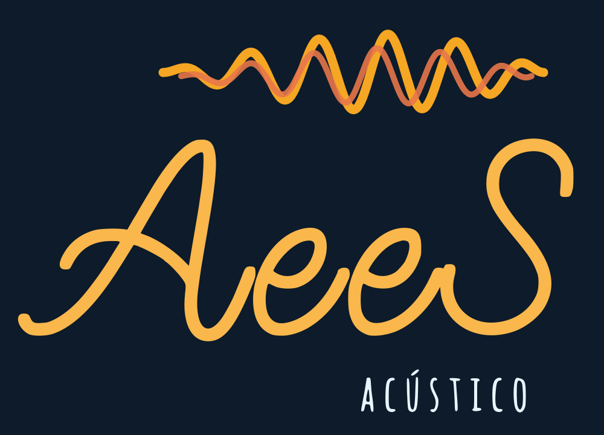
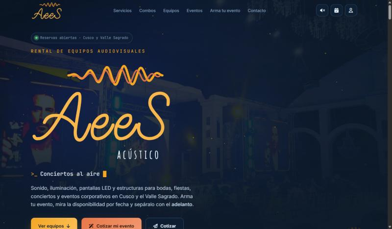
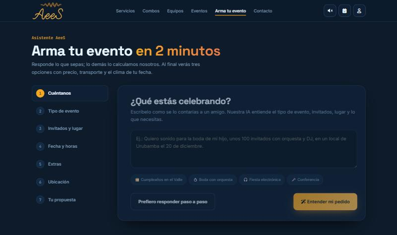
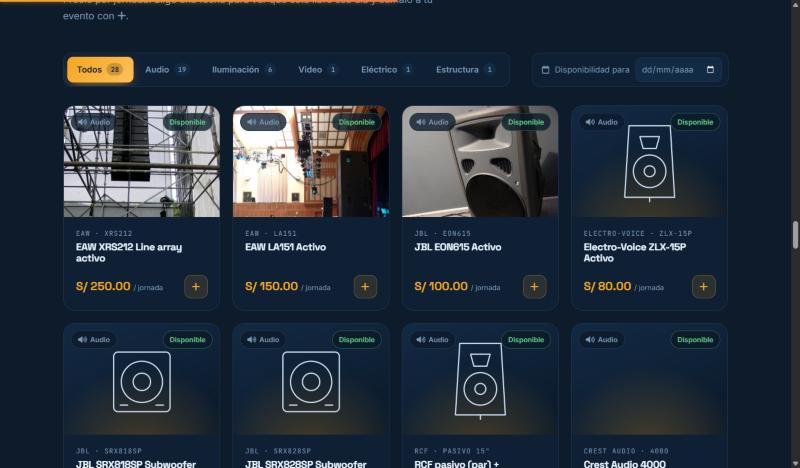
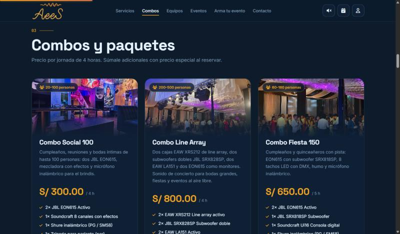
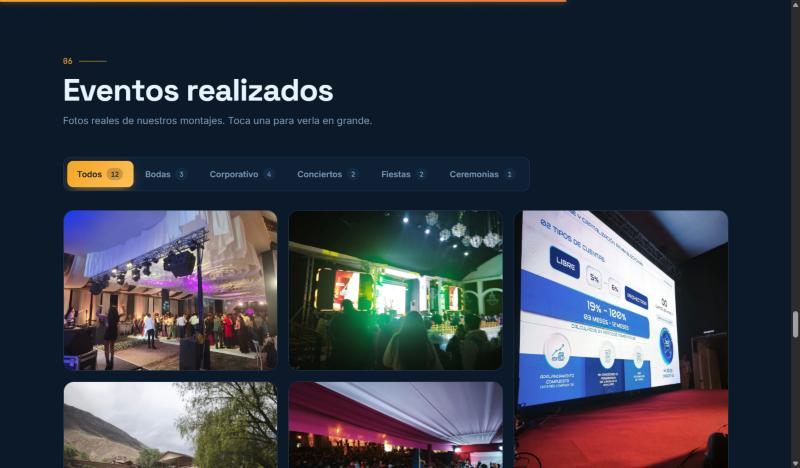
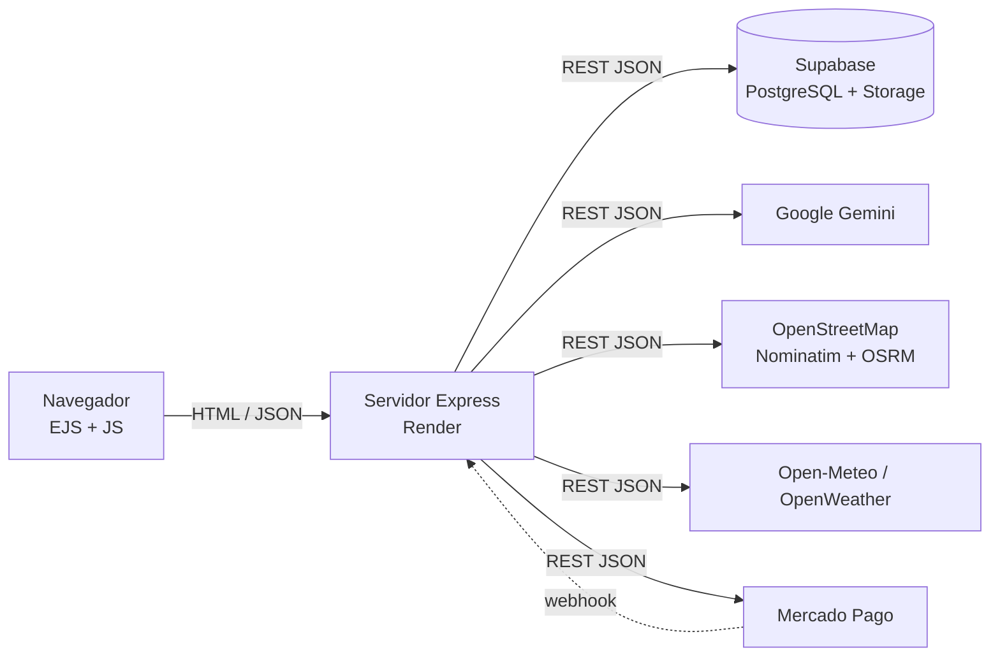

<p align="center">
  
</p>

<h1 align="center">AeeS Acústico — Web de alquiler de equipos audiovisuales</h1>

<p align="center">
  Sonido, iluminación, pantallas LED y estructuras para bodas, fiestas, conciertos y eventos corporativos en Cusco y el Valle Sagrado.
</p>

<p align="center">
  <a href="https://aees-web.onrender.com"></a>
</p>

<p align="center">
  
  
  
  
  
  
  
</p>

---

## Tabla de contenidos

1. [Descripción](#1-descripción)
2. [Demo y capturas](#2-demo-y-capturas)
3. [Funcionalidades](#3-funcionalidades)
4. [APIs integradas](#4-apis-integradas)
5. [Arquitectura](#5-arquitectura)
6. [Tecnologías](#6-tecnologías)
7. [Estructura del proyecto](#7-estructura-del-proyecto)
8. [Instalación y ejecución local](#8-instalación-y-ejecución-local)
9. [Variables de entorno](#9-variables-de-entorno)
10. [API REST del proyecto](#10-api-rest-del-proyecto)
11. [Base de datos](#11-base-de-datos)
12. [Reglas del negocio](#12-reglas-del-negocio)
13. [Despliegue](#13-despliegue)
14. [Pruebas](#14-pruebas)
15. [Seguridad](#15-seguridad)
16. [Solución de problemas](#16-solución-de-problemas)
17. [Hoja de ruta](#17-hoja-de-ruta)
18. [Créditos y licencias de terceros](#18-créditos-y-licencias-de-terceros)
19. [Autores y licencia](#19-autores-y-licencia)

---

## 1. Descripción

**AeeS Acústico** es una empresa de alquiler de equipos audiovisuales en Cusco. Esta aplicación web le permite:

- **Al cliente:** ver el catálogo real de equipos y combos con **disponibilidad por fecha**, armar su evento con un **asistente con inteligencia artificial**, ubicar el lugar en un **mapa** con ruta y costo de transporte calculados, ver el **clima** del día y **reservar pagando un adelanto**.
- **Al negocio:** administrar equipos, combos, precios, reservas, pagos, clientes, promociones y la galería de eventos desde un **panel con roles**.

> Proyecto de fin de la **Unidad II** del curso **Desarrollo de Software II** — Ingeniería de Sistemas, Universidad Andina del Cusco. Requisito: una plataforma que resuelva un problema real integrando **3 APIs externas** que intercambian mensajes **JSON** por HTTP.

## 2. Demo y capturas

| Recurso | Enlace |
|---|---|
| Sitio público | https://aees-web.onrender.com |
| Asistente "Arma tu evento" | https://aees-web.onrender.com/asistente |
| Panel de administración | https://aees-web.onrender.com/admin (acceso solo para el personal) |
| Estado del servidor | https://aees-web.onrender.com/salud |

> El hosting gratuito "se duerme" tras 15 minutos sin visitas: la primera carga puede tardar unos 50 segundos.

| Portada | Asistente con IA |
|---|---|
|  |  |
| **Catálogo con disponibilidad** | **Combos y paquetes** |
|  |  |



## 3. Funcionalidades

### Sitio público
- Logo del negocio animado (ondas que vibran) y botón de volumen; con sonido activo, los títulos "suenan" al pasar el mouse (Web Audio API).
- Efectos de escenario: haces de luz, ecualizador interactivo en canvas, tilt 3D, botones magnéticos, cursor personalizado, aparición al hacer scroll.
- Catálogo con filtros por categoría, ficha técnica en modal y **disponibilidad real para la fecha elegida**.
- Combos con **adicionales de precio especial**, galería de eventos realizados con vista ampliada, contacto por formulario o WhatsApp.

### Asistente "Arma tu evento"
1. El cliente escribe con sus palabras (*"boda de 150 invitados con orquesta en Urubamba"*) y la **IA lo convierte en la encuesta**.
2. Completa tipo de evento, invitados, interior o exterior, fecha, horas y extras.
3. Marca el lugar en el **mapa**: se calcula la ruta real desde el almacén.
4. Recibe **3 opciones** (Esencial, Recomendada y Premium) más un combo sugerido, con transporte, técnico, clima y una explicación personalizada.

### Reservas y pagos
- Registro en un paso: **Google** o **celular + PIN**. El DNI se pide recién al reservar, con consentimiento según la Ley N.° 29733.
- El adelanto (40 % por defecto) **bloquea los equipos y la fecha durante 24 h**; pago con **Yape** (verificado por el admin) o **Mercado Pago**.
- Agenda de la **reunión de confirmación**. Si la fecha está ocupada, el cliente puede solicitar una alternativa con un proveedor aliado.

### Panel de administración (`/admin`)
| Rol | Acceso |
|---|---|
| **Administrador** | Agenda y calendario, reservas, pagos, clientes, mensajes, equipos, combos, galería, promociones, ajustes del negocio y tarifas, personal, respaldo |
| **Publicador** | Combos y galería |

- CRUD con validación en el servidor, interruptor de publicado, estados de equipo (operativo, mantenimiento, baja).
- Armador de combos con **vista previa en vivo** y comparación con el precio de los equipos sueltos.
- Subida de fotos con **recorte a la proporción del sitio** y conversión a **WebP**.
- **Respaldo**: descarga y restauración de todos los datos en JSON.

## 4. APIs integradas

Todas se consumen desde el servidor y comunican mensajes **JSON** por HTTP.

| # | Rol | API | Uso | Archivo | Plan B si falla |
|---|---|---|---|---|---|
| 1 | Mapa y rutas | **OpenStreetMap** — Nominatim + OSRM (OpenRouteService opcional) | Geocodificar el lugar, ruta real por carretera, km y minutos, enlace para el conductor | `src/servicios/rutas.js` | Estimación en línea recta × 1.35 |
| 2 | Inteligencia artificial | **Google Gemini** (gratuita) o **Claude** de Anthropic | Interpretar texto libre → JSON de la encuesta; redactar la explicación | `src/servicios/ia.js` | Intérprete por palabras clave |
| 3 | Pagos | **Mercado Pago Checkout Pro** + Yape manual | Cobro del adelanto; verificación por webhook y consulta a la API | `src/servicios/pagos.js` | Yape con número de operación |
| + | Clima | **OpenWeather** / **Open-Meteo** | Pronóstico del día del evento; sugiere toldo si llueve | `src/servicios/clima.js` | Aviso por temporada de lluvias |

**Ejemplo de mensaje con la API de IA:**
```text
→ {"texto": "Quiero sonido para la boda de mi hijo, 150 invitados con orquesta en Urubamba el 20 de diciembre"}
← {"tipo_evento":"boda","personas":150,"espacio":"exterior","lugar":"Urubamba","fecha":"2026-12-20","extras":{"orquesta":true,"dj":false}}
```

> **Decisión de diseño:** la IA **no decide** qué equipos van ni cuánto cuestan. Eso lo hace el motor de reglas `src/servicios/recomendador.js` con el stock real del día. La IA solo interpreta y redacta. Así los precios nunca se inventan, y si la IA falla el sitio sigue funcionando.

## 5. Arquitectura



- El navegador **nunca accede directamente** a la base de datos ni a las claves: todo pasa por el servidor.
- La capa de datos (`src/db/`) tiene **dos motores con la misma interfaz**: Supabase en producción y un archivo JSON local para desarrollo (patrón *Repository*).

## 6. Tecnologías

| Capa | Tecnología |
|---|---|
| Servidor | Node.js 22, Express 5, cookie-session |
| Vistas | EJS, HTML5, CSS3 (variables, grid, animaciones), JavaScript sin frameworks |
| Librerías del navegador (CDN) | Leaflet, GSAP, SweetAlert2, Cropper.js, Font Awesome |
| Base de datos y archivos | Supabase (PostgreSQL y Storage), `@supabase/supabase-js` |
| IA | Google Gemini (REST), Claude (`@anthropic-ai/sdk`) |
| Despliegue | Render (Blueprint), Vercel (configurado) |
| Pruebas | `node:test` (corredor nativo de Node) |

## 7. Estructura del proyecto

```text
aees_web/
├── app.js                   # Arma la app Express: seguridad, sesión, CSRF, rutas, errores
├── server.js                # Enciende el servidor (Render / PC)
├── api/index.js             # Entrada para Vercel
├── render.yaml              # Blueprint de Render
├── vercel.json              # Configuración de Vercel
├── data/semilla.json        # Inventario real, combos, ajustes y galería iniciales
├── supabase/esquema.sql     # Tablas de PostgreSQL
├── scripts/cargar-semilla.js
├── src/
│   ├── db/                  # Acceso a datos: supabase.js | local.js (misma interfaz)
│   ├── lib/                 # seguridad.js (scrypt, CSRF, límites), util.js
│   ├── middleware/auth.js   # Sesión y roles
│   ├── rutas/               # publico, cuenta, api, pagos, admin
│   └── servicios/           # catalogo, precios, recomendador, transporte, rutas, clima, ia, pagos, reservas
├── views/                   # Plantillas EJS (sitio, cuenta, panel admin, parciales)
├── public/                  # css, js, img (logo, eventos, equipos)
├── test/reglas.test.js      # Pruebas de las reglas del negocio
└── docs/                    # Capturas y contexto del proyecto
```

## 8. Instalación y ejecución local

**Requisitos:** Node.js 22 y Git. En Windows PowerShell, ejecuta los comandos **uno por uno** (PowerShell no usa `&&`).

```powershell
git clone https://github.com/020200141d-coder/aees_web.git
```
```powershell
cd aees_web
```
```powershell
npm install
```
```powershell
Copy-Item .env.example .env
```

Edita `.env` y completa al menos `ADMIN_EMAIL`, `ADMIN_PASS` y `SESSION_SECRET`. Sin las claves de Supabase, los datos se guardan en `data/db.local.json`.

```powershell
npm run dev
```

Abre http://localhost:3000 y el panel en http://localhost:3000/admin.

| Script | Qué hace |
|---|---|
| `npm start` | Inicia el servidor (producción) |
| `npm run dev` | Inicia con recarga automática |
| `npm test` | Ejecuta las pruebas |
| `npm run semilla` | Carga equipos, combos, galería y ajustes en la base activa |

## 9. Variables de entorno

Plantilla completa en [`.env.example`](.env.example). **Nunca subas el archivo `.env` a GitHub.**

| Variable | Obligatoria | Descripción |
|---|---|---|
| `ADMIN_EMAIL`, `ADMIN_PASS` | Sí | Cuenta de administrador que se crea al arrancar si no existe |
| `SESSION_SECRET` | Sí | Texto aleatorio para firmar la cookie de sesión |
| `NODE_ENV`, `PORT`, `BASE_URL` | En producción | Modo, puerto y URL pública (la usa Mercado Pago) |
| `SUPABASE_URL`, `SUPABASE_SERVICE_KEY` | Recomendada | Base de datos; usar la clave **secret**, nunca la *publishable* |
| `GEMINI_API_KEY` | Opcional | IA gratuita ([aistudio.google.com/apikey](https://aistudio.google.com/apikey)) |
| `ANTHROPIC_API_KEY` | Opcional | IA de pago (Claude) |
| `GOOGLE_CLIENT_ID` | Opcional | Ingreso con Google |
| `MP_ACCESS_TOKEN` | Opcional | Mercado Pago (de prueba: empieza con `TEST-`) |
| `OPENWEATHER_API_KEY`, `ORS_API_KEY` | Opcional | Clima y rutas con clave propia |

## 10. API REST del proyecto

| Método | Ruta | Descripción | Sesión |
|---|---|---|---|
| GET | `/api/equipos?fecha=AAAA-MM-DD` | Catálogo con unidades libres ese día | No |
| POST | `/api/interpretar` | Texto libre → campos de la encuesta (IA) | No |
| POST | `/api/recomendar` | Encuesta → 3 opciones, combo, ruta, clima y explicación | No |
| GET | `/api/geocodificar?q=` | Buscar un lugar | No |
| POST | `/api/ruta` | Ruta desde el almacén hasta el lugar | No |
| GET | `/api/clima?lat=&lng=&fecha=` | Pronóstico del día | No |
| POST | `/api/cotizar` | Precio final del evento armado | No |
| POST | `/api/reservas` | Crear la reserva | Cliente |
| POST | `/api/contacto` | Mensaje o cotización | No |
| POST | `/api/solicitudes` | Fecha ocupada → pedir reunión | No |
| POST | `/pagos/mercadopago/webhook` | Aviso de pago de Mercado Pago | — |
| GET | `/salud`, `/salud/base` | Estado del servidor y de la base | No |

Respuestas en JSON: `{ "ok": true, ... }` o `{ "ok": false, "error": "..." }`. Códigos usados: `200`, `400` (validación), `401` (sin sesión), `403` (CSRF o rol), `404`, `409` (equipo ya reservado esa fecha), `429` (demasiadas peticiones), `500`.

## 11. Base de datos

Definida en [`supabase/esquema.sql`](supabase/esquema.sql):

| Tabla | Contenido |
|---|---|
| `ajustes` | Datos del negocio, reglas de precios, vehículos y fotos de portada |
| `equipos` | Inventario: precio por jornada, stock, rol técnico, medidas para el transporte, foto y crédito |
| `combos` | Paquetes con sus equipos y adicionales |
| `promociones` | Códigos de descuento |
| `publicaciones` | Galería de eventos realizados |
| `usuarios` | Clientes y personal (roles `admin`, `publicador`, `cliente`) |
| `reservas` | Evento, equipos, desglose de precio, adelanto, estado y reunión |
| `pagos` | Pagos por Mercado Pago, Yape o registro manual |
| `mensajes` | Cotizaciones y solicitudes de fecha ocupada |

Todas las tablas tienen **Row Level Security** activado y sin políticas públicas: solo el servidor puede leer y escribir.

**Configurar Supabase:** crear un proyecto gratuito → **SQL Editor** → ejecutar `supabase/esquema.sql` → copiar la URL y la clave *secret* al `.env` → `npm run semilla`.

## 12. Reglas del negocio

Todas son editables en **Admin → Negocio y tarifas**.

- Precio por **jornada de 4 horas**; 8 horas equivalen a 2 jornadas. Con un combo, la jornada es la duración del combo.
- **Adelanto del 40 %** con bloqueo de 24 horas; técnico S/ 150 por jornada; cliente frecuente (2 o más reservas pagadas) con 10 % de descuento.
- Precio por cantidad y sin DMX (por ejemplo, tachos LED: S/ 25, S/ 20 desde 13 unidades y S/ 5 menos sin controlador DMX).
- **Transporte** = base + S/ por km de ida, eligiendo el vehículo más barato en el que entra la carga por volumen, peso y largo: auto, station wagon o camioncito.
- Recomendador por **perfil acústico**: SPL alto para fiestas electrónicas y conciertos, baile para bodas y cumpleaños, inteligibilidad de la voz para eventos corporativos. Para eventos al aire libre suma un 40 % de invitados.

## 13. Despliegue

### Render (principal)
1. **New → Blueprint** → elegir este repositorio: Render lee `render.yaml`.
2. Completar las variables (`ADMIN_EMAIL`, `ADMIN_PASS`, `SUPABASE_URL`, `SUPABASE_SERVICE_KEY`, `GEMINI_API_KEY`…). Pega cada clave **en una sola línea**.
3. **Deploy**. El chequeo de salud es `/salud`. Cada `git push` a `main` vuelve a desplegar automáticamente.

### Vercel (alternativo)
Importar el repositorio con el preset **Other** y las mismas variables. `vercel.json` dirige todas las rutas a `api/index.js`. En Vercel es obligatorio usar Supabase.

## 14. Pruebas

```powershell
npm test
```

13 pruebas automáticas de las reglas del negocio:
- Jornadas y factor de tiempo.
- Precio por cantidad y sin DMX.
- Combos y adicionales.
- Capacidad de los vehículos y tarifa Cusco–Urubamba.
- Perfiles del recomendador y reemplazo de equipos ocupados.
- Intérprete por palabras clave.
- Llamada simulada a la API de Gemini, con su plan B.

## 15. Seguridad

- Contraseñas y PIN guardados con **scrypt** y comparación en tiempo constante.
- **CSRF** con token por sesión en formularios y peticiones `fetch`.
- **Content Security Policy**, `nosniff`, `X-Frame-Options` y `Referrer-Policy`.
- Límite de peticiones en el login, la IA, los mapas y el contacto.
- Validación de todos los datos en el servidor; **los precios siempre se recalculan en el servidor**.
- Control de doble reserva y expiración automática de reservas no pagadas.
- Las claves solo existen en variables de entorno; la base de datos tiene RLS sin acceso público.

## 16. Solución de problemas

| Síntoma | Causa probable | Solución |
|---|---|---|
| La primera carga tarda unos 50 s | Render gratis estaba dormido | Normal; usar un ping cada 10 min (cron-job.org) |
| Páginas con error 500 y `/salud/base` con error | Clave o URL de Supabase mal pegada, o proyecto pausado | Revisar **Environment** en Render; reactivar el proyecto en Supabase |
| El asistente responde sin IA | Gemini saturado (503) o sin clave | El plan B responde igual; reintentar más tarde |
| Despliegue fallido | Error en el último commit | Render mantiene la versión anterior; usar **Rollback** y revisar los **Logs** |
| No aparece el pago con tarjeta | Falta `MP_ACCESS_TOKEN` | Agregar el token de prueba de Mercado Pago |

## 17. Hoja de ruta

El avance detallado está en [`PLAN.md`](PLAN.md). Próximos pasos: fotos propias de cada equipo, pruebas de Mercado Pago en producción, Culqi como segunda pasarela, facturación electrónica, verificación del celular por WhatsApp y conexión de la app Flutter a la misma base de datos.

## 18. Créditos y licencias de terceros

- **Logo y fotos de eventos:** propiedad de AeeS Acústico.
- **Fotos referenciales de equipos:** Wikimedia Commons, con licencias CC BY, CC BY-SA o dominio público; el autor, la licencia y el enlace se muestran en la ficha de cada equipo.
- **Mapas:** © colaboradores de OpenStreetMap (ODbL); rutas con OSRM.
- **Clima:** Open-Meteo (CC BY 4.0) / OpenWeather.
- **Íconos:** Font Awesome Free. **Librerías:** Leaflet, GSAP, SweetAlert2 y Cropper.js, con sus respectivas licencias.

## 19. Autores y licencia

| Integrante | Carrera |
|---|---|
| **Edson Francisco Lino Aguirre Bravo** | Ingeniería de Sistemas — Universidad Andina del Cusco |
| **Adrian Mauricio Paredes Claros** | Ingeniería de Sistemas — Universidad Andina del Cusco |

AeeS Acústico, Cusco, Perú · WhatsApp: [+51 987 166 001](https://wa.me/51987166001)

Código bajo licencia [MIT](LICENSE). El logo, la marca y las fotos propias de AeeS Acústico **no** están incluidos en esa licencia.
